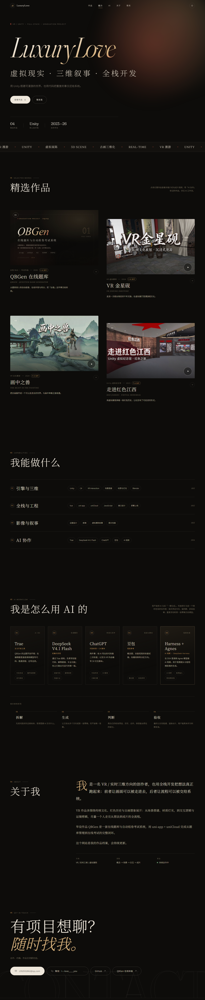

# LuxuryLove · 个人作品网站

一个纯静态的个人作品集网站：深色电影感排版 + 中英混排 + 作品详情弹窗，
目前收录 4 件作品：**QBGen 在线题库（毕设，全栈 Web）**，以及 3 件 Unity / VR 作品
（VR 虚拟展馆、古画漫游、虚拟纪念馆），成片视频已内置，点击即可播放；
另有一个 **AI 工作流**区块，展示常用的 AI 工具与使用原则。

新增内容只需要改 **`data.js`** 一个文件，然后把它交给我 / 或自己复制一段即可。



---

## 1. 本地预览

网站不需要构建、不需要安装任何依赖。但因为是本地文件，**直接双击 `index.html` 有时会有字体 / 视频路径问题**，建议起一个本地服务器：

**方式 A（最简单，Windows）**
双击 `start.cmd`，它会启动一个本地服务器并提示地址（默认 http://127.0.0.1:8080）。

**方式 B（有 Python 时）**
```powershell
python -m http.server 8080
```
然后浏览器打开 http://127.0.0.1:8080

**方式 C（有 Node 时）**
```powershell
npx serve .
```

手机上想看效果：浏览器开发者工具（F12）→ 点左上角手机图标 → 选 390px 宽度。

---

## 2. 文件说明

| 文件 | 作用 | 一般要不要改 |
| --- | --- | --- |
| `data.js` | **所有内容**：名字、简介、联系方式、作品列表、能力标签 | 要改 |
| `index.html` | 页面骨架（一般不动） | 基本不动 |
| `styles.css` | 配色、字体、排版、动效 | 想换风格时改 |
| `main.js` | 渲染作品卡片、详情弹窗、主题切换等交互 | 一般不动 |
| `assets/covers/` | 作品封面图（已从原始封面压缩到 1600px 宽） | 加新作品时放这里 |
| `assets/videos/` | 网页播放用的 MP4（三件 VR 作品，共约 55MB） | 已配好，换片时才动 |
| `assets/qbgen-cover.html` | QBGen 封面图的源文件，想改封面文案可以改它再截图 | 可选 |
| `preview/` | 设计预览截图，可删 | — |

---

## 3. 修改基本信息

打开 `data.js`，最上面就是这些：

```js
const SITE = {
  name: "LuxuryLove",
  siteTitle: "LuxuryLove · VR 作品集",
  tagline: "用 Unity 搭建可漫游的世界，把文化、历史与想象装进虚拟现场。",
  eyebrow: "VR DEVELOPER / 3D SCENE / VIRTUAL EXHIBITION",
  scrollHint: "向下滚动 · 查看作品",

  contact: {
    email: "1392932862@qq.com",
    wechat: "I---love____you",
    links: [
      { label: "GitHub", url: "https://github.com/Luxurylove" },
      { label: "QBGen 在线体验", url: "https://luxurylove.github.io/QBGen/" },
    ],
  },
  ...
}
```

改完保存、刷新浏览器即可生效。

> 头像是可选的：把一张竖版照片放到 `assets/avatar.jpg`，再把 `about.avatar` 改成 `"assets/avatar.jpg"` 就会显示在「关于我」区块。

---

## 4. 新增一件作品

在 `data.js` 的 `works: [ ... ]` 里，**复制一整块 `{ ... }` 粘贴到列表最前面**，然后改内容：

```js
{
  id: "new-work",              // 唯一英文编号，不能和别的重复
  title: "作品名称",
  en: "WORK TITLE IN ENGLISH",
  category: "VR 应用",          // 卡片上的分类
  year: "2025",
  subtitle: "一句话说清它是什么、亮点在哪。",
  cover: "assets/covers/new-work.jpg",   // 封面图放进 assets/covers/
  model: "Unity · 你的技术方向",
  duration: "02:00",
  summary: [
    "第一段：项目背景、要解决什么问题。",
    "第二段：你的思路和做法。",
  ],
  highlights: [
    "你独立完成的部分（越具体越好）",
    "技术难点与解决方式",
    "最终效果 / 数据",
  ],
  tags: ["Unity", "VR", "场景搭建"],
  link: "https://luxurylove.github.io/QBGen/",  // 可留 null；有链接时详情页出现「在线体验」按钮
  linkLabel: "在线体验",                          // 按钮文字，可省略
  video: { src: "assets/videos/new-work.mp4" },  // 暂时没视频就写 null
  gallery: [],                                    // 额外截图，可留空
}
```

封面图建议：**16:10 横图，1600px 宽左右**，单张 300KB 以内最理想。
（原始封面图可以直接用，网站会用 `object-fit: cover` 自动裁切。）

保存后刷新，作品数量、卡片序号、首屏的「03 精选作品」都会自动更新。

---

## 5. 把成片视频放进网站

现在三件 VR 作品的成片已经压好放进 `assets/videos/` 了（1280×800 / 30fps，共约 55MB），弹窗里点播放按钮即可直接播放，不需要再处理：

| 作品 | 网页版文件 | 大小 |
| --- | --- | --- |
| VR 金星砚 | `assets/videos/jinyan.mp4` | 约 23 MB |
| 画中之兽 | `assets/videos/beast.mp4` | 约 18 MB |
| 走进红色江西 | `assets/videos/jiangxi.mp4` | 约 13 MB |

原始 `.mov` 文件（200–280MB）留着做母版即可，不需要上传。

如果以后想换更清晰 / 更小的版本，用 ffmpeg 重新压：

```powershell
ffmpeg -i "《VR金星砚》.mov" -vf "scale=1280:-2" -r 30 -c:v libx264 -crf 24 -preset slow -c:a aac -b:a 128k -movflags +faststart assets/videos/jinyan.mp4
```

> 如果以后传到 B 站，也可以把 `video` 改成嵌入地址：
> `video: { embed: "https://player.bilibili.com/player.html?bvid=BVxxxxxx&page=1" }`

---

## 6. 新增 / 修改 AI 工具

AI 区块在 `data.js` 的 `ai` 里，改文字或加工具都在这里：

```js
ai: {
  intro: "我不是把 AI 当成「一键生成」……",
  tools: [
    { name: "Trae", category: "AI IDE", role: "主力开发工具", desc: "……", uses: ["代码生成"] },
    // 新工具照着加一条，会自动排进卡片网格（一行放不下会自动换行）
  ],
  workflow: [
    { title: "拆解", desc: "……" },
    // 使用原则，默认四步
  ],
}
```

想让某件作品卡片上显示「AI 协作」角标，并让详情页列出工具与用途：

```js
aiTools: ["Trae", "DeepSeek V4.1 Flash", "ChatGPT"],
aiNote: "Trae 中调用 DeepSeek 写初版代码，ChatGPT 负责二次检测。",
```

当前 AI 工具对应关系：

| 场景 | 工具 / 模型 | 用在哪 |
| --- | --- | --- |
| 主力开发 | Trae + DeepSeek V4.1 Flash | QBGen 的代码生成与功能实现 |
| 检测与脚本 | ChatGPT | QBGen 代码检测；三件 VR 作品的 C# 脚本 |
| 视觉参考 | 豆包 | 概念图、封面参考 |
| AI 视频 | DeepSeek Harness + Agnes | AI 视频生成（作品待加入） |

## 7. 换颜色 / 换风格

所有颜色都在 `styles.css` 顶部的 `:root` 里：

```css
:root {
  --bg: #0c0b09;        /* 背景 */
  --text: #eee7db;      /* 正文 */
  --accent: #d9b27c;    /* 金色重点色 */
  --accent-2: #c2523f;  /* 朱红点缀 */
}
```

`html[data-theme="light"]` 里是亮色主题的对应变量，网站右上角的太阳/月亮按钮可以切换，选择会被记住。

字体用的是 Google Fonts（Fraunces + Noto Serif SC），国内网络加载不到时会自动回退到系统宋体 / 苹方，不影响排版。

---

## 8. 发布上线

这是纯静态网站，把整个文件夹（去掉 `.mov` 原片）传上去就能用：

- **GitHub Pages**：新建仓库 → 上传文件 → Settings → Pages → 选 main 分支根目录
- **Vercel / Netlify**：直接拖文件夹进去，几秒出地址
- **国内服务器 / 对象存储**：上传后把 `index.html` 设为默认首页

`.mov` 原片和 `preview/` 不需要上传，`start.cmd` 也不需要。

---

## 9. 当前收录

| # | 作品 | 类型 | 年份 | 说明 |
| --- | --- | --- | --- | --- |
| 01 | QBGen 在线题库 | 全栈 Web · 毕设 | 2026 | uni-app + uniCloud 在线题库与自动组卷考试系统，附在线体验入口 |
| 02 | VR 金星砚 | Unity VR 展馆 | 2024 | 成片 02:22 |
| 03 | 画中之兽 | Unity 古画漫游 | 2024 | 成片 01:50 |
| 04 | 走进红色江西 | Unity 虚拟纪念馆 | 2023 | 成片 01:20 |

AI 工作流：Trae（主力开发，配合 DeepSeek V4.1 Flash 生成初版代码）、ChatGPT（代码检测 + VR 作品的 C# 脚本）、
豆包（视觉参考）、DeepSeek Harness + Agnes（AI 视频），外加「拆解 → 生成 → 判断 → 验收」四步使用原则。

以后有新课设、比赛、实习项目，直接告诉我「加一个作品，叫 xxx，做了 xxx」，
我会把它补进 `data.js` 并配好封面和详情页。

